# fg-taller-git-2026

Taller de Git y modelado orientado a objetos — Lenguaje de Programación 3 (CYT646), 2026.
Servicio HTTP (Spring Boot 4, Java 21, API REST) sobre el modelado de **Counter-Strike 2**, con estado persistido en **H2**, OpenAPI 3 y un escenario que consulta a dos compañeros (POO-09).

Licencia: Apache License 2.0 (ver `LICENSE`). Bitácora de asistencia de IA: [`BITACORA.md`](BITACORA.md). Colecciones de Insomnia: [`insomnia/`](insomnia/).

- OpenAPI 3 (JSON): `http://localhost:8080/v3/api-docs` · Swagger UI: `http://localhost:8080/swagger-ui.html`
- Escenario POO-09: `POST /api/escenarios/granada` · jugadas guardadas: `GET /api/escenarios/jugadas`

## 1. Situación de POO-08 (los 3 puntos)

POO-08 tuvo observaciones en los criterios 2 y 3. **Todas están cerradas**:

| # | Observación de la corrección | Cómo se cerró | Commit |
|---|---|---|---|
| 1 | Criterio 2: varios controllers usaban los repositorios (`ArmaCrudController` con `ArmaRepository`, y además lanzaba `ValorInvalidoException`; `JugadorController` con `JugadorRepository`; `InspeccionController` con los tres; el historial de `SimulacionController` con `DisparoRepository`). La capa service es obligatoria. | Se crearon `ArmaService`, `JugadorService` e `InspeccionService` (con su `impl`), y `SimulacionService.historial(...)`. **Ningún controller importa un repositorio**: solo traducen HTTP y llaman a un service. El 400 de "nada para actualizar" lo lanza `ArmaServiceImpl.actualizar`. | `refactor: controllers solo hablan con services…` |
| 2 | Criterio 2: el dominio lanzaba excepciones y tenía las reglas (`Arma` validaba en el constructor con `validarNombre`/`validarPrecio`, `ArmaDeFuego.disparar` lanzaba `SinMunicionException`, `Jugador.recibirDanio` y `verificarQuePuedeDisparar` lanzaban `JugadorEliminadoException`). | El paquete `domain` ya **no tiene ningún `throw` ni importa excepciones**: los constructores solo asignan y las entidades solo guardan su estado encapsulado (`aplicarImpacto`, `estadoDeUso()`). Las validaciones están en `ArmaServiceImpl`/`JugadorServiceImpl` (con `Validador`), y las dos reglas en `ReglasDeJuegoService` (`verificarQuePuedeUsarse`, `verificarQuePuedeDisparar`, `verificarQuePuedeRecibirDanio`, `calcularImpacto`). Prueba: `ValidacionesServiceTest` y `ReglasDeJuegoServiceTest`. | `refactor: validaciones, reglas y excepciones pasan a la capa service…` |
| 3 | Criterio 3: `Granada.lanzar()` esperaba un `cooldownMs` y volvía a detonar la misma granada (y una en enfriamiento respondía 201 con 0 de daño). En CS2 una granada es de un solo uso. | La granada es un **consumible**: tiene `usada` (sin cooldown ni recarga; hereda "sin recarga"). Al lanzarla queda usada, y otro intento lo frena el **service** (`ReglasDeJuegoService.verificarQuePuedeUsarse`) con su propia excepción `GranadaUsadaException` → **409 `GRANADA_USADA`**, sin guardar nada. Prueba: `unaGranadaEsDeUnSoloUso` e Insomnia POO-09, pedidos 18–20. | `fix: la granada es un consumible de un solo uso…` |

Verificado en la VM: `./mvnw test` con todas las pruebas en verde.

## 2. Mapa del grupo (round robin, CS2)

Somos un **trío de Counter-Strike 2**. Cada uno es A1 en su propia entrega. En la mía:

| Rol | Integrante | Repositorio | URL base (en mi prueba local) | OpenAPI | Sus dos reglas, en una frase cada una |
|---|---|---|---|---|---|
| **A1** (mi servicio) | Fabricio González | [FabricioG29/fg-taller-git-2026](https://github.com/FabricioG29/fg-taller-git-2026) | `http://localhost:8080` | `http://localhost:8080/v3/api-docs` · UI `/swagger-ui.html` | **Munición:** cada disparo gasta balas del cargador y con el cargador vacío no se dispara (409 `SIN_MUNICION`); una granada se usa una sola vez (409 `GRANADA_USADA`). **Daño con chaleco:** el chaleco absorbe la mitad del daño y la vida nunca queda negativa; con vida 0 el jugador está eliminado (422 `JUGADOR_ELIMINADO`). Publicadas sin estado en `POST /api/reglas/municion` y `POST /api/reglas/danio`. |
| **A2** | Matias Enciso | [MatiasEnc/menciso-tp-lp3-2026](https://github.com/MatiasEnc/menciso-tp-lp3-2026) (proyecto en `cs2/`) | `http://localhost:8081` | `http://localhost:8081/v3/api-docs` | **Regla 1:** el daño de la granada se atenúa con la distancia al radio de la explosión (fuego amigo al 35 %) y una distancia negativa se rechaza (400). **Regla 2:** el chaleco Kevlar absorbe parte del impacto y se desgasta; el resto baja la vida. **Consulto:** `GET /api/simulacion/explosion?distancia=&conBlindaje=&fuegoAmigo=` (solo lectura). |
| **A3** | Diana Aquino | [dianamariapaz2104/daquino-tp-lp3-2026](https://github.com/dianamariapaz2104/daquino-tp-lp3-2026) | `http://localhost:8082` | `http://localhost:8082/v3/api-docs` · UI `/swagger-ui/index.html` | **Regla 1:** recargar exige balas positivas que entren en el cargador (409 `MunicionInsuficienteException`). **Regla 2:** la explosión de una granada se calcula por radio con absorción del Kevlar, y se rechaza el fuego amigo (422 `FuegoAmigoException`) y la distancia negativa o mayor a 35 m (400). **Consulto:** `POST /api/armas/granadas/simular?equipoAtacante=&equipoObjetivo=&distancia=`. |

Las reglas de A2 y A3 salen de su OpenAPI y de su README (enlaces de arriba); no copié código de ellos. En sus entregas yo soy A3 y me levantan en el puerto 8082.

## 3. Cómo clonar y arrancar los tres servicios

Cada uno en su terminal. Primero A2 y A3, después A1 (el escenario los necesita arriba; si no están, responde 503 y no guarda nada).

```bash
# Terminal 1 — A2: Matias Enciso en :8081 (el proyecto está en la subcarpeta cs2/)
git clone https://github.com/MatiasEnc/menciso-tp-lp3-2026.git
cd menciso-tp-lp3-2026/cs2
./mvnw spring-boot:run -Dspring-boot.run.arguments=--server.port=8081

# Terminal 2 — A3: Diana Aquino en :8082
git clone https://github.com/dianamariapaz2104/daquino-tp-lp3-2026.git
cd daquino-tp-lp3-2026
./mvnw spring-boot:run -Dspring-boot.run.arguments=--server.port=8082

# Terminal 3 — A1: mi servicio en :8080 (base vacía)
git clone https://github.com/FabricioG29/fg-taller-git-2026.git
cd fg-taller-git-2026
rm -rf data/
./mvnw spring-boot:run
```

Si A2 o A3 corren en otra máquina de la sala, no se toca el código:

```bash
A2_BASE_URL=http://10.40.x.x:8080 A3_BASE_URL=http://10.40.y.y:8080 ./mvnw spring-boot:run
```

Pruebas: `./mvnw test` (no necesita a los compañeros: usa dobles HTTP que responden según su OpenAPI).

## 4. Escenario: «lanzar una granada HE a un rival»

**En una frase:** un jugador lanza una granada a un rival a cierta distancia; la jugada vale solo si **A2** (Matias) dice cuánto daño llega a esa distancia y **A3** (Diana) acepta que el lanzamiento es legal (no es fuego amigo y está dentro de los 35 m); entonces se gasta la granada, el chaleco absorbe su parte y la jugada queda en mi H2.

```http
POST /api/escenarios/granada
{"atacanteId": 1, "objetivoId": 2, "granadaId": 1, "distancia": 2.0}
```

| Paso | Quién | Qué decide | Si dice que no |
|---|---|---|---|
| 1 | A1 (yo, sin red) | Existen los jugadores y la granada; la granada no está usada; nadie está eliminado; el atacante puede usarla | 404 / 409 `GRANADA_USADA` / 422 / 400 |
| 2 | **A2** — Matias | Daño de la explosión a esa distancia (`danioAtenuadoDistancia / danioNominal`) | 409 `RECHAZO_A2` |
| 3 | **A3** — Diana | Si el lanzamiento es legal: equipos distintos y distancia 0..35 m | 409 `RECHAZO_A3` |
| 4 | A1 | Gasta la granada, aplica mi regla del chaleco al daño atenuado y **guarda la jugada** | — |

**Por qué este orden.** Primero mis reglas, porque no tiene sentido salir a la red con una granada ya usada o un jugador eliminado. Después **A2**, porque es una consulta de solo lectura (GET) que mide la explosión y descarta lo físicamente imposible (distancia negativa) antes de preguntar si es legal. **A3** va al final como última puerta antes de escribir: si el lanzamiento no es legal en la partida, no se toca nada. Además, con este orden cada rechazo se puede provocar por separado: una distancia negativa la frena A2 (A3 no se llega a consultar) y el fuego amigo lo frena A3 (A2 aceptó).

**Qué queda en mi base después de un escenario exitoso.** Una fila nueva en la tabla `JUGADA` (atacante, objetivo, granada, distancia, factor de A2, daño, reparto chaleco/vida, y lo que respondió cada compañero), la granada con `usada = true` y el objetivo con menos vida y chaleco. Se ve con `GET /api/escenarios/jugadas`, `GET /api/escenarios/jugadas/{id}`, `GET /api/jugadores/{id}`, `GET /api/armas/{id}` o en la consola de H2.

**Qué queda igual si A2 acepta y A3 rechaza.** Todo: no hay fila nueva en `JUGADA`, la granada sigue sin usar y el objetivo conserva su vida y su chaleco. Nada se escribe antes de tener las dos respuestas, y el método es `@Transactional`, así que cualquier excepción deshace lo que hubiera.

Respuesta de un rechazo (ejemplo, A3 por fuego amigo):

```json
{"status":409,"error":"RECHAZO_A3","excepcion":"RechazoDeCompaneroException",
 "mensaje":"A3 (Diana Aquino) rechazó la jugada con HTTP 422: no se guardó nada",
 "rol":"A3","companero":"Diana Aquino",
 "urlConsultada":"http://localhost:8082/api/armas/granadas/simular?equipoAtacante=Terrorista&equipoObjetivo=Terrorista&distancia=2.0",
 "statusCompanero":422,"respuestaCompanero":"{…lo que respondió Diana…}","estadoH2":"SIN_CAMBIOS"}
```

## 5. Qué hay que pensar (POO-09)

**OpenAPI.** Lo genera springdoc (`springdoc-openapi-starter-webmvc-ui` 3.1.1, la línea para Spring Boot 4) en `GET /v3/api-docs`, con la interfaz en `/swagger-ui.html`. La cabecera (`OpenApiConfig`) explica las dos reglas y el formato de los errores. Cada operación tiene `@Operation` y `@ApiResponse` con ejemplos: el CRUD de armas y jugadores, la simulación (`POST /api/simulaciones/disparos`, con 409 `SIN_MUNICION`/`GRANADA_USADA` y 422 `JUGADOR_ELIMINADO`), las dos reglas sin estado (`POST /api/reglas/municion` y `/danio`, pensadas para que me consulten) y el escenario (409 `RECHAZO_A2`/`RECHAZO_A3`, 503). Los errores tienen esquema propio (`ErrorRespuesta`, `RechazoRespuesta`). Un extraño puede importar el JSON en Insomnia e invocar todo sin ver el `.java`.

**Grupo.** A1 soy yo (Fabricio González), A2 es Matias Enciso y A3 es Diana Aquino; los tres somos de CS2 y formamos un trío. Las reglas de cada uno están en la tabla de la [sección 2](#2-mapa-del-grupo-round-robin-cs2), con el enlace a su repositorio (README y OpenAPI).

**Escenario.** El hecho es lanzar una granada HE a un rival: necesita la medida de A2 (cuánto daño llega a esa distancia) y el visto bueno de A3 (no es fuego amigo, está en alcance). Después de un éxito se ve la jugada en `JUGADA`, la granada usada y el objetivo herido. Si A2 acepta y A3 rechaza, la base queda exactamente igual (sección 4).

**Cliente.** `ClienteExplosionA2` y `ClienteGranadaA3` (paquete `client`) usan `RestClient` de Spring. Las URLs, las rutas y los nombres de equipo de A3 se leen de `application.properties`, y cada una se puede pisar con una variable de entorno:

| Propiedad | Por defecto | Variable de entorno |
|---|---|---|
| `companeros.a2.base-url` | `http://localhost:8081` | `A2_BASE_URL` |
| `companeros.a2.ruta` | `/api/simulacion/explosion` | `A2_RUTA` |
| `companeros.a3.base-url` | `http://localhost:8082` | `A3_BASE_URL` |
| `companeros.a3.ruta` | `/api/armas/granadas/simular` | `A3_RUTA` |
| `companeros.a3.equipo-terroristas` / `equipo-antiterroristas` | `Terrorista` / `Counter-Terrorista` | — |
| `companeros.timeout-ms` | `3000` | `COMPANEROS_TIMEOUT_MS` |

**Errores.** No propago el código del compañero tal cual: lo **traduzco a mi jerarquía** y guardo el original. `CompaneroException` (abstracta, hija de `JuegoException`) tiene dos hijas: `RechazoDeCompaneroException` (el compañero respondió 4xx: su regla dijo que no → **409** con `error` `RECHAZO_A2` o `RECHAZO_A3`) y `CompaneroNoDisponibleException` (apagado, timeout, 5xx o ruta inexistente → **503** `COMPANERO_NO_DISPONIBLE_A2/A3`). El cuerpo (`RechazoRespuesta`) lleva `rol`, `companero`, `urlConsultada`, `statusCompanero` y `respuestaCompanero`, así el handler distingue «falló A2» de «falló A3», y `estadoH2: "SIN_CAMBIOS"`. Uso 409 y no el 400/422 del compañero porque para mi cliente el pedido es correcto: lo que falla es una regla ajena.

**Límite.** No cloné código de A2 ni de A3 para copiar reglas: los clientes solo conocen la ruta, los parámetros y los códigos de su OpenAPI, y `ExplosionA2` lee solo los campos que necesito (`@JsonIgnoreProperties(ignoreUnknown = true)`). **Pregunta de anclaje:** si un compañero cambia el nombre de una ruta, alcanza con actualizar `companeros.a2.ruta` / `companeros.a3.ruta` (o `A2_RUTA` / `A3_RUTA`) según su nuevo OpenAPI; no hay ninguna clase de su dominio en mi código.

**Si un compañero no responde.** El cliente corta a los 3 s y el escenario responde 503 atribuido (A2 o A3) sin guardar nada; no reintento solo, porque repetir un pedido no arregla un servicio apagado. Lo que hago: (1) aviso al compañero por el grupo con la URL que falló; (2) pruebo con su commit clonado en mi máquina (sección 3); (3) las pruebas automáticas (`EscenarioServiceTest`, `ClientesCompanerosTest`) usan dobles HTTP que responden lo que dice su OpenAPI; (4) las respuestas reales del caso feliz y de cada rechazo quedan guardadas en `insomnia/respuestas-poo09/` para la corrección.

## 6. Colecciones de Insomnia

**POO-09** — `insomnia/fg-taller-git-2026-poo09.json`. Entorno con `base_a1`, `base_a2` y `base_a3`. Orden: levantar A2 y A3, borrar `data/` y levantar A1 (sección 3), importar y correr 00 → 24.

| Carpeta | Pedidos | Qué muestra |
|---|---|---|
| 1. OpenAPI | 00–02 | OpenAPI propio, el de A2 y el de A3 (los tres arriba) |
| 2. Preparar | 03–08 | Jugadores Fabri (T), Rival (CT), Compa (T) y tres granadas HE |
| 3. Caso feliz | 09–12 | 201 con la jugada; `GET` de jugadas, del Rival herido y de la granada usada |
| 4. Rechazos | 13–17 | 409 `RECHAZO_A2` (distancia −3) y 409 `RECHAZO_A3` (fuego amigo); después, la base igual |
| 5. POO-08 | 18–20 | La granada no se usa dos veces: 409 `GRANADA_USADA` (escenario y simulación) |
| 6. Mis reglas | 21–24 | Las dos reglas que consultan mis compañeros: 200 / 409 / 200 / 422 |

Sin Insomnia: `bash insomnia/recorrido-poo09.sh` hace lo mismo con `curl` y guarda cada respuesta en `insomnia/respuestas-poo09/NN.txt` (son las respuestas de ejemplo para cuando un compañero no está en línea).

**POO-08** — `insomnia/fg-taller-git-2026-poo08.json` (01 → 29, con la base vacía) y `bash insomnia/recorrido.sh`: CRUD, simulación y un error por tipo.

## 7. Cómo arrancar solo mi servicio

```bash
./mvnw spring-boot:run          # http://localhost:8080/
./mvnw test                     # reglas, validaciones, clientes y escenario
rm -rf data/                    # empezar con la base vacía (hace falta si venís de POO-08: cambió la tabla ARMA)
```

Consola de H2: http://localhost:8080/h2-console → JDBC URL `jdbc:h2:file:./data/cs2db`, usuario `sa`, contraseña vacía. Tablas: `ARMA`, `JUGADOR`, `DISPARO` y `JUGADA`.

### Propiedades de H2 y JPA (`application.properties`)

| Propiedad | Valor | Qué hace |
|---|---|---|
| `spring.datasource.url` | `jdbc:h2:file:./data/cs2db` | H2 corre dentro del proceso y guarda la base en `data/cs2db.mv.db`, así el estado sobrevive a un reinicio. |
| `spring.datasource.driver-class-name` | `org.h2.Driver` | Driver JDBC de H2. |
| `spring.datasource.username` / `password` | `sa` / vacío | Usuario por defecto de H2; solo para desarrollo. |
| `spring.jpa.hibernate.ddl-auto` | `update` | Hibernate crea las tablas que faltan y no borra los datos al arrancar. |
| `spring.jpa.open-in-view` | `false` | La sesión de base termina con el service; el controller no hace consultas escondidas. |
| `spring.h2.console.enabled` / `path` | `true` / `/h2-console` | Consola web de H2 (solo desarrollo). |
| `springdoc.api-docs.path` / `swagger-ui.path` | `/v3/api-docs` / `/swagger-ui.html` | Dónde se publica el OpenAPI. |
| `companeros.*` | ver sección 5 | URLs y rutas de A2 y A3. |

`data/` está en `.gitignore`: la base es local y se regenera sola.

## 8. Paquetes (según `alefq/lp3-template-tp`)

```text
src/main/java/py/edu/uc/
├── lp3/
│   ├── FgTallerGit2026Application.java   solo arranca
│   ├── config/           OpenApiConfig (cabecera del OpenAPI)
│   ├── constants/        ApiPaths, EjemplosOpenApi
│   ├── domain/           Arma (+ hijas), Jugador, Disparo, Jugada, Inspeccionable, EstadoUso, Impacto…  (solo estado)
│   ├── repository/       ArmaRepository, JugadorRepository, DisparoRepository, JugadaRepository
│   ├── service/          ArmaService, JugadorService, InspeccionService, SimulacionService,
│   │   │                 ReglasDeJuegoService, EscenarioService
│   │   ├── dto/          cuerpos JSON de entrada y salida (records, solo datos)
│   │   └── impl/         implementaciones (@Service, @Transactional) y Validador
│   ├── client/           ClienteCompanero, ClienteExplosionA2, ClienteGranadaA3 (HTTP a los compañeros)
│   └── rest/
│       ├── controller/   solo traducen HTTP → service (ninguno usa un repositorio)
│       └── handler/      ManejoErrores (un @ExceptionHandler por tipo), ErrorRespuesta, RechazoRespuesta
└── lp3exceptions/        JuegoException y sus hijas
```

## 9. API

| Método y URL | Qué hace | Éxito |
|---|---|---|
| `GET /` | Servicio vivo y lista de endpoints | 200 |
| `GET /v3/api-docs`, `/swagger-ui.html` | OpenAPI 3 | 200 |
| `POST /api/armas` | Crea un arma; `"tipo"` elige la hija (`pistola`, `rifle`, `francotirador`, `escopeta`, `subfusil`, `granada`) | 201 + `Location` |
| `GET /api/armas[?equipo=…\|?precioMaximo=…]` | Lista lo persistido | 200 |
| `GET /api/armas/{id}` · `PATCH /api/armas/{id}` · `DELETE /api/armas/{id}` | Leer, cambiar nombre/precio, borrar | 200 / 200 / 204 |
| `POST /api/armas/{id}/recarga` | Pasa balas de la reserva al cargador | 200 |
| `POST /api/jugadores`, `GET /api/jugadores[?vivos=true]`, `GET /api/jugadores/{id}` | Jugadores | 201 / 200 |
| `POST /api/simulaciones/disparos` | Simulación: `{atacanteId, objetivoId, armaId, veces}` | 201 |
| `GET /api/disparos[?objetivoId=…\|?atacanteId=…]` | Historial de la simulación | 200 |
| `GET /api/inspeccion` | Protocolo `Inspeccionable` | 200 |
| `POST /api/reglas/municion` · `POST /api/reglas/danio` | Mis dos reglas sin estado (para los compañeros) | 200 |
| `POST /api/escenarios/granada` | **Escenario POO-09** (consulta A2 y A3) | 201 |
| `GET /api/escenarios/jugadas[/{id}]` | Jugadas guardadas | 200 |

## 10. Las dos reglas y las excepciones

1. **Munición** (`ReglasDeJuegoService.verificarQuePuedeUsarse`): cada disparo gasta balas del cargador; con el cargador vacío el arma no dispara (`SinMunicionException`, 409) hasta recargar desde la reserva. Una granada se usa una vez (`GranadaUsadaException`, 409).
2. **Daño con chaleco** (`calcularImpacto`, `verificarQuePuedeDisparar`, `verificarQuePuedeRecibirDanio`): el chaleco absorbe la mitad del daño (hasta lo que le queda) y se gasta; el resto baja la vida, que nunca queda negativa; con vida 0 el jugador está eliminado y no dispara ni recibe daño (`JugadorEliminadoException`, 422).

**Simulación** (`POST /api/simulaciones/disparos`): `SimulacionServiceImpl` aplica las dos reglas en cada disparo y le pide a las entidades que cambien su estado (`arma.usar()`, `objetivo.aplicarImpacto(...)`); en una transacción cambian el arma, el objetivo y se crean los `Disparo`. Si una regla falla a la mitad, se deshace todo. Ejemplo (Insomnia POO-08, pedido 15): Glock-18 × 3 contra Rival (100/100) → vida 58, chaleco 61, Glock 17/120.

```text
RuntimeException
└── JuegoException (abstracta, lleva un código)
    ├── ValorInvalidoException            400  VALOR_INVALIDO
    ├── RecursoNoEncontradoException      404  RECURSO_NO_ENCONTRADO
    ├── ReglaDeJuegoException (abstracta)
    │   ├── SinMunicionException          409  SIN_MUNICION
    │   ├── GranadaUsadaException         409  GRANADA_USADA
    │   └── JugadorEliminadoException     422  JUGADOR_ELIMINADO
    └── CompaneroException (abstracta)
        ├── RechazoDeCompaneroException   409  RECHAZO_A2 / RECHAZO_A3
        └── CompaneroNoDisponibleException 503 COMPANERO_NO_DISPONIBLE_A2 / _A3
```

Todas las lanza la **capa service** (o el cliente HTTP, en el caso de los compañeros); el dominio no lanza nada. `ManejoErrores` tiene un `@ExceptionHandler` por tipo y además traduce el JSON ilegible a 400 `JSON_INVALIDO`.

## 11. Qué hay que pensar (POO-08, actualizado)

**Recurso y verbo.** Los sustantivos son `armas`, `jugadores`, `disparos` y `jugadas`; la URL nombra el recurso y el verbo dice la operación. La simulación es `POST /api/simulaciones/disparos` porque crea disparos; el escenario es `POST /api/escenarios/granada` porque crea una jugada.

**Identidad.** La clave es `id` (`Long`), la asigna H2 (`IDENTITY`). El JSON de creación no la lleva; la respuesta 201 la devuelve en el cuerpo y en `Location`.

**Herencia y tablas.** `SINGLE_TABLE`: toda la familia `Arma` vive en `arma` y la columna `tipo` dice la hija. Casi todo se pide "a cualquier arma", así que una sola tabla evita `JOIN`; el costo son columnas `NULL` de las otras hijas. En el JSON el subtipo sale en `"tipo"`.

**Capas.** Controller → service → repositorio. El controller solo conoce la interface del service; el service conoce la interface del repositorio (Spring Data genera la implementación). Cambiar H2 por otra base toca el driver y las propiedades, no el dominio ni los controllers.

**Protocolo del dominio.** `Inspeccionable` la implementan `Arma` (con `ArmaDeFuego` y `Granada` que suman munición o si ya se usó), `Jugador`, `Disparo` y `Jugada`. `GET /api/inspeccion` les manda el mismo mensaje sin preguntar el tipo.

**Ocultamiento.** Atributos privados y sin setters públicos: JPA usa un constructor `protected` vacío. Las entidades solo cambian por mensajes (`renombrar`, `cambiarPrecio`, `disparar`, `recargar`, `lanzar`, `aplicarImpacto`) y **no validan**: los valores llegan ya revisados por el service. Un `POST` ilegal responde 400 y la colección no crece (Insomnia POO-08, 20–21); una simulación que falla a la mitad deja todo como estaba (24–25).

**PUT y PATCH.** Solo `PATCH` (`nombre`, `precio`): reemplazar el recurso entero permitiría escribir munición o cambiar el tipo de arma.

**DELETE.** Borra la fila (204; 404 si no existe). `Disparo` y `Jugada` guardan id y nombre del arma, no una clave foránea: el historial sigue legible.

**Excepciones.** Cada hija se llama como la regla que falló; son no comprobadas para que suban al handler y para que `@Transactional` deshaga la transacción.

## 12. Sobreescritura y sobrecarga (POO-06)

### Sobreescritura (`@Override`): misma firma, la clase hija cambia el comportamiento

| Método | Declarado en | Sobreescrito en | Qué hace cada una |
|---|---|---|---|
| `usar()` | `Arma` (**abstracto**) | `ArmaDeFuego`, `Granada` | El arma de fuego dispara y gasta munición; la granada se lanza **una sola vez** (consumible); un segundo uso responde 409 `GRANADA_USADA` |
| `recargar()` | `Arma` (por defecto: "sin recarga") | `ArmaDeFuego` (`final`) | El arma de fuego llena el cargador desde la reserva; la granada hereda "sin recarga" (no se recarga ni tiene cooldown) |
| `calcularDanio()` | `ArmaDeFuego` (daño × precisión) | `Pistola`, `Francotirador`, `Escopeta`, `Subfusil` | Pistola: llama a `super` y resta 20 % en ráfaga. Francotirador: con zoom **reemplaza** al padre (daño × (1 + penetración)). Escopeta: `super` × perdigones. Subfusil: `super` ajustado por retroceso |
| `balasPorDisparo()` | `ArmaDeFuego` (1) | `Pistola`, `RifleAsalto`, `Subfusil` | Pistola: 1 o 3 en ráfaga. Rifle: lo decide el `ModoDisparo`. Subfusil: 2 |

`ComportamientoController` recorre una `List<Arma>` y llama a `usar()` / `recargar()` sin preguntar el tipo: Java elige en **tiempo de ejecución** la versión de la clase real del objeto.

### Sobrecarga: mismo nombre, distinta lista de parámetros, en la misma clase

| Clase | Firmas | Para qué |
|---|---|---|
| `Pistola` (constructor) | `Pistola(nombre, precio, equipo, danio)` y `Pistola(nombre, precio, equipo, danio, precision, cargador, reserva)` | La corta crea una pistola "de fábrica" (precisión, cargador y reserva estándar) y delega con `this(...)` en la completa; `ArmaServiceImpl` elige cuál usar y valida antes de construir |
| `ArmaDeFuego` (mensaje) | `disparar()` y `disparar(int veces)` | Un disparo, o varios seguidos; la versión con `int` reutiliza `disparar()` (el límite de veces lo valida `SimulacionService`) |

### Cómo distinguirlas

| | Sobreescritura | Sobrecarga |
|---|---|---|
| Firma | Igual a la del padre | Mismo nombre, **parámetros distintos** |
| Dónde | Clase hija respecto de la padre | Normalmente en la misma clase |
| Se decide | En ejecución, según el objeto real | Al compilar, según los argumentos |
| Marca | `@Override` | Ninguna |
| Ejemplo acá | `Granada.usar()` reemplaza a `Arma.usar()` | `disparar()` vs `disparar(3)` |

## 13. Diagrama de clases

```mermaid
classDiagram
  direction TB

  class Inspeccionable {
    <<interface>>
    +inspeccionar() String
  }

  class Arma {
    <<abstract>>
    -Long id
    -String nombre
    -int precio
    -Equipo equipo
    -int danio
    #Arma()
    +usar() ResultadoAccion*
    +recargar() ResultadoAccion
    +estadoDeUso() EstadoUso
    +renombrar(String nombre) void
    +cambiarPrecio(int precio) void
    +esDelEquipo(Equipo e) boolean
  }

  class ArmaDeFuego {
    <<abstract>>
    -float precision
    -int capacidadCargador
    -int municionCargador
    -int municionReserva
    +usar() ResultadoAccion
    +disparar() ResultadoAccion
    +disparar(int veces) List~ResultadoAccion~
    +recargar() ResultadoAccion
    +estadoDeUso() EstadoUso
  }

  class Granada {
    -float radioExplosion
    -String efecto
    -boolean usada
    +usar() ResultadoAccion
    +lanzar() ResultadoAccion
    +estadoDeUso() EstadoUso
  }

  class Pistola {
    +Pistola(nombre, precio, equipo, danio)
    +Pistola(nombre, precio, equipo, danio, precision, cargador, reserva)
  }
  class RifleAsalto
  class Francotirador
  class Escopeta
  class Subfusil

  class Jugador {
    -Long id
    -String nombre
    -Equipo equipo
    -int vida
    -int armadura
    +aplicarImpacto(Impacto i) void
    +estaEliminado() boolean
  }

  class Disparo {
    -Long atacanteId
    -Long objetivoId
    -Long armaId
    -int danioArma
  }

  class Jugada {
    -Long atacanteId
    -Long objetivoId
    -Long granadaId
    -double distancia
    -double factorDistanciaA2
    -int danioExplosion
    -String respuestaA2
    -String respuestaA3
  }

  class ReglasDeJuegoService {
    <<interface>>
    +verificarQuePuedeUsarse(Arma a) void
    +verificarQuePuedeDisparar(Jugador j, Arma a) void
    +verificarQuePuedeRecibirDanio(Jugador j) void
    +calcularImpacto(vida, armadura, danio) Impacto
    +evaluarMunicion(ReglaMunicionRequest p) EvaluacionMunicion
    +evaluarDanio(ReglaDanioRequest p) Impacto
  }
  class ArmaService {
    <<interface>>
  }
  class JugadorService {
    <<interface>>
  }
  class SimulacionService {
    <<interface>>
    +simularDisparos(atacanteId, objetivoId, armaId, veces) ReporteSimulacion
  }
  class EscenarioService {
    <<interface>>
    +lanzarGranada(EscenarioGranadaRequest p) Jugada
    +jugadas() List~Jugada~
  }

  class ClienteCompanero {
    <<abstract>>
    #consultar(ruta, llamada) T
  }
  class ClienteExplosionA2 {
    +medirExplosion(distancia, conBlindaje, fuegoAmigo) ExplosionA2
  }
  class ClienteGranadaA3 {
    +validarLanzamiento(atacante, objetivo, distancia) String
  }

  class ArmaRepository {
    <<interface>>
  }
  class JugadorRepository {
    <<interface>>
  }
  class DisparoRepository {
    <<interface>>
  }
  class JugadaRepository {
    <<interface>>
  }

  class ArmaCrudController
  class SimulacionController
  class EscenarioController
  class ReglasController

  class JuegoException {
    <<abstract>>
    -String codigo
  }
  class ValorInvalidoException
  class RecursoNoEncontradoException
  class ReglaDeJuegoException {
    <<abstract>>
  }
  class SinMunicionException
  class GranadaUsadaException
  class JugadorEliminadoException
  class CompaneroException {
    <<abstract>>
    -String rol
    -Integer statusCompanero
  }
  class RechazoDeCompaneroException
  class CompaneroNoDisponibleException
  class ManejoErrores

  %% Herencia
  Arma <|-- ArmaDeFuego
  Arma <|-- Granada
  ArmaDeFuego <|-- Pistola
  ArmaDeFuego <|-- RifleAsalto
  ArmaDeFuego <|-- Francotirador
  ArmaDeFuego <|-- Escopeta
  ArmaDeFuego <|-- Subfusil
  ClienteCompanero <|-- ClienteExplosionA2
  ClienteCompanero <|-- ClienteGranadaA3

  %% Interfaces
  Inspeccionable <|.. Arma
  Inspeccionable <|.. Jugador
  Inspeccionable <|.. Disparo
  Inspeccionable <|.. Jugada

  %% Capas: controller -> service -> repositorio
  ArmaCrudController ..> ArmaService : usa
  SimulacionController ..> SimulacionService : usa
  EscenarioController ..> EscenarioService : usa
  ReglasController ..> ReglasDeJuegoService : usa
  ArmaService ..> ArmaRepository : usa
  JugadorService ..> JugadorRepository : usa
  SimulacionService ..> ReglasDeJuegoService : aplica
  SimulacionService ..> DisparoRepository : guarda
  EscenarioService ..> ReglasDeJuegoService : aplica
  EscenarioService ..> ClienteExplosionA2 : 1° consulta A2
  EscenarioService ..> ClienteGranadaA3 : 2° consulta A3
  EscenarioService ..> JugadaRepository : guarda si ambos aceptan

  %% Excepciones
  JuegoException <|-- ValorInvalidoException
  JuegoException <|-- RecursoNoEncontradoException
  JuegoException <|-- ReglaDeJuegoException
  JuegoException <|-- CompaneroException
  ReglaDeJuegoException <|-- SinMunicionException
  ReglaDeJuegoException <|-- GranadaUsadaException
  ReglaDeJuegoException <|-- JugadorEliminadoException
  CompaneroException <|-- RechazoDeCompaneroException
  CompaneroException <|-- CompaneroNoDisponibleException
  ReglasDeJuegoService ..> ReglaDeJuegoException : lanza
  ClienteCompanero ..> CompaneroException : lanza
  ManejoErrores ..> JuegoException : traduce a HTTP
```



Cómo leerlo:

- **Herencia** (`<|--`): `Pistola` es un `ArmaDeFuego`, que es un `Arma`; lo mismo en las excepciones y en los clientes.
- **Interface** (`<|..`): `Arma`, `Jugador`, `Disparo` y `Jugada` cumplen `Inspeccionable`.
- **Capas** (`..>`): los controllers solo usan services; los services usan repositorios, las reglas y los clientes. El dominio no apunta a ninguna excepción: **quien lanza es la capa service** (`ReglasDeJuegoService`) o el cliente HTTP (`ClienteCompanero`).
- **Escenario**: `EscenarioService` consulta primero a A2 y después a A3, y solo guarda la `Jugada` si los dos aceptan.
