# fg-taller-git-2026

Taller de Git y modelado orientado a objetos — Lenguaje de Programación 3 (CYT646), 2026.
Servicio HTTP (Spring Boot 4, Java 21, API REST) sobre el modelado de **Counter-Strike 2**, con estado persistido en **H2**.

Licencia: Apache License 2.0 (ver `LICENSE`). Bitácora de asistencia de IA: [`BITACORA.md`](BITACORA.md). Colección de pruebas: [`insomnia/`](insomnia/).

## Cómo arrancar

```bash
./mvnw spring-boot:run          # http://localhost:8080/
./mvnw test                     # pruebas de las dos reglas (sin Spring)
rm -rf data/                    # opcional: empezar con la base vacía
```

Consola de H2: http://localhost:8080/h2-console → JDBC URL `jdbc:h2:file:./data/cs2db`, usuario `sa`, contraseña vacía. Ahí se ven las tablas `ARMA`, `JUGADOR` y `DISPARO`.

### Propiedades de H2 y JPA (`application.properties`)

| Propiedad | Valor | Qué hace |
|---|---|---|
| `spring.datasource.url` | `jdbc:h2:file:./data/cs2db` | H2 corre dentro del proceso y guarda la base en el archivo `data/cs2db.mv.db`, así el estado sobrevive a un reinicio. |
| `spring.datasource.driver-class-name` | `org.h2.Driver` | Driver JDBC de H2 (viene en el `pom.xml`). |
| `spring.datasource.username` / `password` | `sa` / vacío | Usuario por defecto de H2; solo para desarrollo. |
| `spring.jpa.hibernate.ddl-auto` | `update` | Hibernate crea las tablas que faltan a partir de las entidades y no borra los datos al arrancar. |
| `spring.jpa.show-sql` | `false` | No imprime cada SQL en la consola (se pone en `true` para depurar). |
| `spring.jpa.open-in-view` | `false` | La sesión de base termina con el service; el controller no hace consultas escondidas mientras arma el JSON. |
| `spring.h2.console.enabled` | `true` | Habilita la consola web de H2 (solo desarrollo). |
| `spring.h2.console.path` | `/h2-console` | URL de la consola. |

`data/` está en `.gitignore`: la base es local y se regenera sola.

## Paquetes (según `alefq/lp3-template-tp`)

```text
src/main/java/py/edu/uc/
├── lp3/
│   ├── FgTallerGit2026Application.java   solo arranca
│   ├── constants/        ApiPaths
│   ├── domain/           Arma (+ hijas), Jugador, Disparo, Inspeccionable, ResultadoAccion, Impacto, ReporteSimulacion
│   ├── repository/       ArmaRepository, JugadorRepository, DisparoRepository (interfaces Spring Data)
│   ├── service/          ArmaService, SimulacionService
│   │   └── impl/         implementaciones (@Service, @Transactional)
│   └── rest/
│       ├── controller/   Index, ArmaCrud, Jugador, Inspeccion, Simulacion (+ los de POO-06)
│       ├── dto/          cuerpos JSON de entrada (records)
│       └── handler/      ManejoErrores: un @ExceptionHandler por tipo
└── lp3exceptions/        JuegoException y sus hijas (mismo lugar que en el template)
```

## API

| Método y URL | Qué hace | Éxito |
|---|---|---|
| `GET /` | Servicio vivo y lista de endpoints | 200 |
| `POST /api/armas` | Crea un arma; el campo `"tipo"` elige la hija (`pistola`, `rifle`, `francotirador`, `escopeta`, `subfusil`, `granada`) | 201 + `Location` |
| `GET /api/armas[?equipo=…\|?precioMaximo=…]` | Lista lo persistido | 200 |
| `GET /api/armas/{id}` | Un arma | 200 / 404 |
| `PATCH /api/armas/{id}` | Cambia `nombre` y/o `precio` | 200 |
| `DELETE /api/armas/{id}` | Saca el arma del juego | 204 / 404 |
| `POST /api/armas/{id}/recarga` | Regla de munición: pasa balas de la reserva al cargador | 200 |
| `POST /api/jugadores`, `GET /api/jugadores[?vivos=true]`, `GET /api/jugadores/{id}` | Alta y consulta de jugadores | 201 / 200 |
| `POST /api/simulaciones/disparos` | **Simulación**: `{atacanteId, objetivoId, armaId, veces}` | 201 |
| `GET /api/disparos[?objetivoId=…\|?atacanteId=…]` | Historial persistido de la simulación | 200 |
| `GET /api/inspeccion` | Protocolo `Inspeccionable` sobre armas, jugadores y disparos | 200 |

Errores: el cuerpo siempre es `{"status", "error", "excepcion", "mensaje"}` (ver [Excepciones](#excepciones)).

## Las dos reglas del juego

Participan tres clases persistidas: **`Arma`** (la familia), **`Jugador`** y **`Disparo`**.

1. **Munición** (`ArmaDeFuego.disparar()` / `recargar()`): cada disparo gasta balas del cargador, y con el cargador vacío el arma no dispara y lanza `SinMunicionException` hasta que se recarga desde la reserva.
2. **Daño con chaleco** (`Jugador.recibirDanio(int)`): el chaleco absorbe la mitad del daño (hasta lo que le queda) y se gasta; el resto baja la vida, que nunca queda negativa, y con vida 0 el jugador queda eliminado: no dispara ni recibe más daño (`JugadorEliminadoException`).

**Simulación** (`POST /api/simulaciones/disparos`): el atacante (vivo y con un arma de su bando o de `AMBOS`) dispara `veces` al objetivo. En cada disparo, `arma.usar()` aplica la regla 1 (polimórfico: una granada se lanza) y `objetivo.recibirDanio(...)` aplica la regla 2; cada disparo se guarda como `Disparo`. En una sola transacción cambian a la vez el **arma** (munición), el **objetivo** (vida y chaleco) y se crean los **disparos**. Si una regla falla a la mitad, se deshace todo. Un `GET /api/jugadores/{id}`, `GET /api/armas/{id}` o `GET /api/disparos` posterior muestra el estado ya persistido.

Ejemplo (colección Insomnia, pedido 15): Glock-18 (daño 30, precisión 0.9 → 27 por bala) × 3 contra Rival (100/100): cada disparo, 13 al chaleco y 14 a la vida → Rival queda con vida 58 y chaleco 61, y la Glock con 17/120.

## Excepciones

```text
RuntimeException
└── JuegoException (abstracta, lleva un código)
    ├── ValorInvalidoException          400  VALOR_INVALIDO
    ├── RecursoNoEncontradoException    404  RECURSO_NO_ENCONTRADO
    └── ReglaDeJuegoException (abstracta)
        ├── SinMunicionException        409  SIN_MUNICION
        └── JugadorEliminadoException   422  JUGADOR_ELIMINADO
```

| Excepción | Quién la lanza | Cuándo |
|---|---|---|
| `ValorInvalidoException` | Constructores y mensajes del dominio (`Arma`, `Jugador`, …) | Un valor dejaría al objeto en un estado imposible (daño negativo, NaN, equipo `AMBOS` para un jugador…) |
| `RecursoNoEncontradoException` | Controllers y service, al buscar por id | El id no existe en la base |
| `SinMunicionException` | `ArmaDeFuego.disparar()` | Cargador vacío (regla 1) |
| `JugadorEliminadoException` | `Jugador.recibirDanio()` / `verificarQuePuedeDisparar()` | Jugador con vida 0 (regla 2) |

`ManejoErrores` (`@RestControllerAdvice`) tiene **un `@ExceptionHandler` por cada hija**; además traduce el JSON ilegible (tipo de arma desconocido, enum inválido) a 400 `JSON_INVALIDO`.

## Qué hay que pensar

**Recurso y verbo.** Los sustantivos son `armas`, `jugadores` y `disparos`; la URL nombra el recurso y el verbo HTTP dice la operación (`POST` crea, `GET` lee, `PATCH` cambia, `DELETE` borra). La simulación es `POST /api/simulaciones/disparos` porque crea disparos nuevos. La única acción en la URL es `/api/armas/{id}/recarga`, que es un evento del arma y no un campo que se pueda escribir.

**Identidad.** La clave es `id` (`Long`), la asigna H2 con `@GeneratedValue(strategy = IDENTITY)`. El JSON de creación **no** la lleva (los records de `rest/dto` no tienen `id`); la respuesta 201 la devuelve en el cuerpo y en el encabezado `Location`.

**Herencia y tablas.** Elegí `SINGLE_TABLE`: toda la familia `Arma` vive en la tabla `arma` y la columna `tipo` (`PISTOLA`, `RIFLE`, `GRANADA`…) dice la hija. En mi dominio casi todo se pide "a cualquier arma" (listar, inspeccionar, simular), así que una sola tabla evita `JOIN` y las hijas tienen pocos campos propios. El costo es que las columnas de una hija quedan `NULL` en las filas de las otras. En el JSON el subtipo sale en `"tipo"` (`@JsonTypeInfo(use = NAME)`) al crear y al listar, con nombres propios del juego, no con nombres de clase Java.

**Interfaz y repositorio.** El controller depende de `ArmaRepository`, una **interface**; Spring Data genera la implementación. El controller no sabe si atrás hay H2, PostgreSQL o un repositorio falso de prueba: solo conoce el contrato. Es la misma idea que el protocolo de POO-07: se programa contra la interface y se puede cambiar la implementación sin tocar a quien la usa. Si mañana cambiamos H2 por otra base, se tocan solo el driver en `pom.xml` y las propiedades de `application.properties`; dominio, repositorios y controllers se quedan quietos.

**Protocolo del dominio.** `Inspeccionable` (`String inspeccionar()`) la implementan **tres familias distintas**: `Arma` (con `ArmaDeFuego` y `Granada` que la sobreescriben para sumar munición o cooldown), `Jugador` y `Disparo`. `GET /api/inspeccion` arma una `List<Inspeccionable>` con todo lo persistido y les manda el mismo mensaje sin preguntar el tipo.

**Ocultamiento.** Las reglas numéricas las sostienen los constructores y los mensajes del dominio (`cambiarPrecio`, `recibirDanio`, `disparar`). No hay setters públicos: JPA usa un constructor vacío `protected` (solo visible para la jerarquía y para Hibernate) y lee y escribe los campos por reflexión. El JSON tampoco llega a los campos: los records de `rest/dto` llaman al constructor de negocio. Pruebas 20 y 21 de Insomnia: un `POST` con daño negativo responde 400 y el `GET` siguiente muestra la misma colección que antes. La prueba 25 muestra que una simulación que falla a mitad de camino (`SIN_MUNICION`) deja el arma y el jugador como estaban.

**PUT y PATCH.** Uso solo `PATCH`: cambia un subconjunto (`nombre`, `precio`) y un campo omitido queda igual. No hay `PUT` porque reemplazar el recurso entero permitiría escribir munición o cambiar el tipo de arma, y la munición solo cambia disparando o recargando.

**DELETE.** Borrar es sacar el arma del juego (vendida o descartada): se borra la fila y responde 204; si no existe, 404. No hay un mensaje de dominio porque borrar no tiene reglas propias. Los `Disparo` guardan el id y el nombre del arma (no una clave foránea), así el historial sigue legible aunque el arma ya no exista.

**Dos reglas.** Disparar cambia el **arma** (munición) y el **objetivo** (chaleco y vida) a la vez, y además crea un `Disparo`. El recurso es `/api/simulaciones/disparos`; después, `GET /api/jugadores/{id}`, `GET /api/armas/{id}` y `GET /api/disparos?objetivoId=…` muestran el resultado persistido.

**Excepciones.** Cada hija se llama como la regla que falló. Un recurso inexistente (`RecursoNoEncontradoException`, 404) y una regla de juego incumplida (`ReglaDeJuegoException` → `SinMunicionException` 409 / `JugadorEliminadoException` 422) son tipos distintos: lo primero es un error de la dirección, lo segundo del estado del juego. El JSON lleva `status`, `error` (código estable), `excepcion` (clase) y `mensaje`. Son **no comprobadas** (`RuntimeException`) porque ningún método intermedio puede arreglarlas: suben hasta el handler, y además `@Transactional` deshace la transacción ante una `RuntimeException`. La lanza el **objeto del juego**, no el controller (salvo el 404, que surge al buscar por id).

## Colección de Insomnia

Archivo: `insomnia/fg-taller-git-2026-poo08.json`.

1. Insomnia → **Import** (o *Create → Import*) → elegir el archivo. Se crea la colección "fg-taller-git-2026 · POO-08 (CS2)" con su entorno.
2. Arrancar con la base vacía: `rm -rf data/ && ./mvnw spring-boot:run`.
3. Correr los pedidos **en orden** (01 → 29). El entorno ya trae los ids que asigna H2 en una base vacía (`glockId=1`, `rivalId=2`, …). Si la base no estaba vacía, copiar el `id` de cada respuesta 201 en el entorno (*Manage Environments*).

| Carpeta | Pedidos | Qué muestra |
|---|---|---|
| 1. Arranque | 01 | `GET /` |
| 2. CRUD de armas | 02–10 | POST de 3 hijas, GET colección, GET por id, PATCH, GET filtrado, DELETE y GET 404 |
| 3. Jugadores | 11–13 | Alta con constructor simple |
| 4. Protocolo | 14 | `GET /api/inspeccion` |
| 5. Simulación | 15–19 | Caso feliz con las dos reglas, GET del estado persistido y recarga |
| 6. Errores | 20–29 | `POST` ilegal (400), id inexistente (404), sin munición (409 y rollback), jugador eliminado (422), tipo desconocido (400) |

Sin Insomnia: `bash insomnia/recorrido.sh` hace el mismo recorrido con `curl`.

## Sobreescritura y sobrecarga (POO-06)

### Sobreescritura (`@Override`): misma firma, la clase hija cambia el comportamiento

| Método | Declarado en | Sobreescrito en | Qué hace cada una |
|---|---|---|---|
| `usar()` | `Arma` (**abstracto**) | `ArmaDeFuego`, `Granada` | El arma de fuego dispara y gasta munición; la granada se lanza y respeta el cooldown |
| `recargar()` | `Arma` (por defecto: "sin recarga") | `ArmaDeFuego` (`final`), `Granada` | El arma de fuego llena el cargador desde la reserva; la granada informa cuánto falta del cooldown |
| `calcularDanio()` | `ArmaDeFuego` (daño × precisión) | `Pistola`, `Francotirador`, `Escopeta`, `Subfusil` | Pistola: llama a `super` y resta 20 % en ráfaga. Francotirador: con zoom **reemplaza** al padre (daño × (1 + penetración)). Escopeta: `super` × perdigones. Subfusil: `super` ajustado por retroceso |
| `balasPorDisparo()` | `ArmaDeFuego` (1) | `Pistola`, `RifleAsalto`, `Subfusil` | Pistola: 1 o 3 en ráfaga. Rifle: lo decide el `ModoDisparo`. Subfusil: 2 |

`ComportamientoController` recorre una `List<Arma>` y llama a `usar()` / `recargar()` sin preguntar el tipo: Java elige en **tiempo de ejecución** la versión de la clase real del objeto.

### Sobrecarga: mismo nombre, distinta lista de parámetros, en la misma clase

| Clase | Firmas | Para qué |
|---|---|---|
| `Pistola` (constructor) | `Pistola(nombre, precio, equipo, danio)` y `Pistola(nombre, precio, equipo, danio, precision, cargador, reserva)` | La corta crea una pistola "de fábrica" y delega con `this(...)` en la completa, así las validaciones están en un solo lugar y las dos dejan el objeto válido |
| `ArmaDeFuego` (mensaje) | `disparar()` y `disparar(int veces)` | Un disparo, o varios seguidos; la versión con `int` valida `1..capacidadCargador` y reutiliza `disparar()` |

### Cómo distinguirlas

| | Sobreescritura | Sobrecarga |
|---|---|---|
| Firma | Igual a la del padre | Mismo nombre, **parámetros distintos** |
| Dónde | Clase hija respecto de la padre | Normalmente en la misma clase |
| Se decide | En ejecución, según el objeto real | Al compilar, según los argumentos |
| Marca | `@Override` | Ninguna |
| Ejemplo acá | `Granada.usar()` reemplaza a `Arma.usar()` | `disparar()` vs `disparar(3)` |

## Diagrama de clases

```mermaid
classDiagram
  direction TB

  class Inspeccionable {
    <<interface>>
    +inspeccionar() String
  }

  class Arma {
    <<abstract>>
    -Long id
    -String nombre
    -int precio
    -Equipo equipo
    -int danio
    #Arma()
    +usar() ResultadoAccion*
    +recargar() ResultadoAccion
    +renombrar(String nombre) void
    +cambiarPrecio(int precio) void
    +mostrarEnTienda() String
    +inspeccionar() String
    +esDelEquipo(Equipo e) boolean
  }

  class ArmaDeFuego {
    <<abstract>>
    -float precision
    -int capacidadCargador
    -int municionCargador
    -int municionReserva
    -float tiempoRecarga
    +usar() ResultadoAccion
    +disparar() ResultadoAccion
    +disparar(int veces) List~ResultadoAccion~
    +recargar() ResultadoAccion
    #calcularDanio() int
    #balasPorDisparo() int
  }

  class Granada {
    -float radioExplosion
    -String efecto
    -long cooldownMs
    -long ultimoLanzamientoMs
    +usar() ResultadoAccion
    +lanzar() ResultadoAccion
    +recargar() ResultadoAccion
  }

  class Pistola {
    -boolean modoRafaga
    +Pistola(nombre, precio, equipo, danio)
    +Pistola(nombre, precio, equipo, danio, precision, cargador, reserva)
  }
  class RifleAsalto
  class Francotirador
  class Escopeta
  class Subfusil

  class Jugador {
    -Long id
    -String nombre
    -Equipo equipo
    -int vida
    -int armadura
    +Jugador(nombre, equipo)
    +Jugador(nombre, equipo, vida, armadura)
    +recibirDanio(int danio) Impacto
    +verificarQuePuedeDisparar(Arma a) void
    +estaEliminado() boolean
    +inspeccionar() String
  }

  class Disparo {
    -Long id
    -Long atacanteId
    -Long objetivoId
    -Long armaId
    -int danioArma
    -int absorbidoPorArmadura
    -int danioVida
    -int vidaRestante
    +inspeccionar() String
  }

  class ArmaRepository {
    <<interface>>
    +findByEquipoOrderByIdAsc(Equipo e) List~Arma~
    +findByPrecioLessThanEqualOrderByPrecioAsc(int p) List~Arma~
  }
  class JugadorRepository {
    <<interface>>
    +findByVidaGreaterThanOrderByIdAsc(int v) List~Jugador~
  }
  class DisparoRepository {
    <<interface>>
    +findByObjetivoIdOrderByIdAsc(Long id) List~Disparo~
  }
  class JpaRepository {
    <<interface>>
  }

  class ArmaCrudController
  class SimulacionController
  class InspeccionController
  class SimulacionServiceImpl {
    +simularDisparos(atacanteId, objetivoId, armaId, veces) ReporteSimulacion
    +recargar(armaId) Arma
  }

  class JuegoException {
    <<abstract>>
    -String codigo
  }
  class ValorInvalidoException
  class RecursoNoEncontradoException
  class ReglaDeJuegoException {
    <<abstract>>
  }
  class SinMunicionException
  class JugadorEliminadoException
  class ManejoErrores

  %% Herencia (es un)
  Arma <|-- ArmaDeFuego
  Arma <|-- Granada
  ArmaDeFuego <|-- Pistola
  ArmaDeFuego <|-- RifleAsalto
  ArmaDeFuego <|-- Francotirador
  ArmaDeFuego <|-- Escopeta
  ArmaDeFuego <|-- Subfusil

  %% Implementación de interface
  Inspeccionable <|.. Arma
  Inspeccionable <|.. Jugador
  Inspeccionable <|.. Disparo
  JpaRepository <|-- ArmaRepository
  JpaRepository <|-- JugadorRepository
  JpaRepository <|-- DisparoRepository

  %% Uso del repositorio
  ArmaCrudController ..> ArmaRepository : usa
  InspeccionController ..> Inspeccionable : usa
  SimulacionController ..> SimulacionServiceImpl : usa
  SimulacionServiceImpl ..> ArmaRepository : usa
  SimulacionServiceImpl ..> JugadorRepository : usa
  SimulacionServiceImpl ..> DisparoRepository : usa
  SimulacionServiceImpl ..> Disparo : crea

  %% Jerarquía de excepciones
  JuegoException <|-- ValorInvalidoException
  JuegoException <|-- RecursoNoEncontradoException
  JuegoException <|-- ReglaDeJuegoException
  ReglaDeJuegoException <|-- SinMunicionException
  ReglaDeJuegoException <|-- JugadorEliminadoException
  ArmaDeFuego ..> SinMunicionException : lanza
  Jugador ..> JugadorEliminadoException : lanza
  ManejoErrores ..> JuegoException : traduce a HTTP
```



Cómo leerlo:

- **Herencia** (`<|--`, línea llena): "es un". `Pistola` es un `ArmaDeFuego`, que es un `Arma`. También entre excepciones y entre repositorios y `JpaRepository`.
- **Implementación de interface** (`<|..`, línea punteada con triángulo): `Arma`, `Jugador` y `Disparo` cumplen el contrato `Inspeccionable`.
- **Uso del repositorio** (`..>` "usa"): controllers y service dependen de las interfaces `…Repository`, no de una implementación.
- **Jerarquía de excepciones**: `JuegoException` → `ValorInvalido`, `RecursoNoEncontrado` y `ReglaDeJuego` → `SinMunicion`, `JugadorEliminado`; `..> "lanza"` marca qué clase del dominio lanza cada regla.
